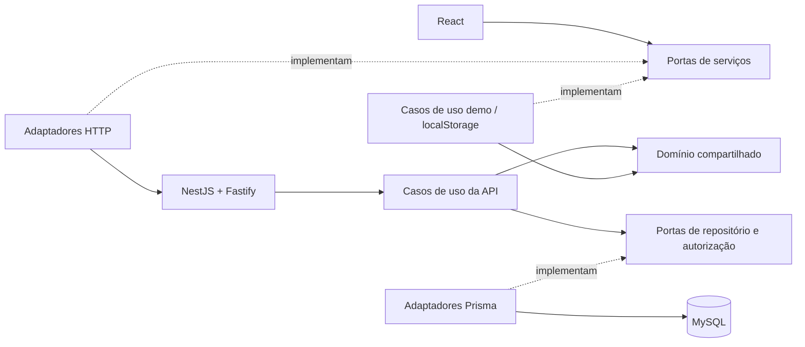

# Arquitetura

Monorepo com monólito modular na API e frontend React. DDD organiza os contextos; portas e adaptadores separam domínio/aplicação de NestJS, Fastify, Prisma, React e navegador. Nenhum módulo de negócio importa o framework para validar preços, catálogo ou checkout.

## Mapa de responsabilidades

| Pasta                          | Responsabilidade                                                                      |
| ------------------------------ | ------------------------------------------------------------------------------------- |
| `src/app`                      | Composição de serviços demo/API, rotas e escopos React                                |
| `src/modules/identity`         | Acesso à conta, seleção de loja, senha e adaptador de autenticação                    |
| `src/modules/catalog`          | Produtos, categorias, cardápio e adaptadores HTTP/local                               |
| `src/modules/restaurant`       | Configurações e estado da loja                                                        |
| `src/modules/checkout`         | Carrinho, entrega e envio/preparação de pedido                                        |
| `src/modules/orders`           | Pedidos persistidos, etapas, detalhes e paginação                                     |
| `src/modules/demo-orders`      | Quadro fictício isolado, apenas no modo demo                                          |
| `src/shared`                   | Resultados, diagnóstico, transporte HTTP genérico e UI reutilizável                   |
| `backend/src/app`              | Configuração, composição manual, bootstrap Nest/Fastify e OpenAPI                     |
| `backend/src/modules/identity` | Conta, sessões, tenants, memberships e políticas de acesso                            |
| `backend/src/modules/catalog`  | Leitura pública/privada, produtos, categorias e configurações do agregado restaurante |
| `backend/src/modules/orders`   | Registro transacional, idempotência, listagem e transições                            |
| `backend/src/shared`           | Portas técnicas, executor, Prisma, criptografia e tradução HTTP de erros              |
| `packages/domain`              | Regras portáteis sem React, Zod, Node ou banco                                        |
| `packages/contracts`           | DTOs, schemas estritos e tipos públicos compartilhados                                |

Cada contexto cria somente as camadas que utiliza: `domain`, `application`, `infrastructure`, `presentation`. Não existem diretórios vazios nem repositório base genérico. As fachadas antigas em `src/**/domain` reexportam o pacote puro para preservar imports e testes do frontend.

## Dependências permitidas

- Domínio depende de domínio e tipos de contrato; o pacote `domain` não tem dependências externas.
- Aplicação depende de domínio, portas e schemas; não conhece NestJS, Prisma, React ou navegador.
- Apresentação traduz HTTP/interação e chama serviços injetados.
- Infraestrutura implementa as portas e valida dados externos. A API Prisma pode compartilhar leitura transacional do agregado entre catálogo e pedidos.
- `shared` não depende de regras de módulos. As composições `src/app/composition.ts`, `src/app/api-services.ts` e `backend/src/app/composition.ts` ligam as implementações.
- Fronteiras são verificadas por `scripts/check-architecture.mjs` e `backend/scripts/check-architecture.mjs`; os testes de contrato complementam a regra estática.

## Dinheiro, resultados e contratos

`Cents` é inteiro de 0 a 2.147.483.647; produtos exigem valor positivo. A entrada aceita `28.90` ou `28,90`, até duas casas decimais, sem milhares ou texto residual. Não há cálculo em ponto flutuante de preços armazenados.

`MenuDocument` contém `schemaVersion: 1`, `revision`, `restaurant`, `categories` e `products`. É um snapshot público validado, não uma representação das tabelas. Produtos/categorias pertencem à loja; nomes normalizados de categorias são únicos.

Casos de uso retornam `Result<T, AppError>` discriminado por `ok`. O erro contém `code`, mensagem segura, campos e `diagnosticId`. Adaptadores lançam `Failure`; `Operation`/`Executor` convertem em resultado e registram apenas diagnóstico sanitizado. O cliente valida também respostas HTTP.

## Tenancy e persistência real

Tenant é a organização; restaurant é a unidade/loja. Uma sessão identifica o usuário, não autoriza um tenant por si só. `AccessPolicy` consulta sessão ativa, membership ativo e tenant ativo antes de liberar o escopo `{ tenantId, restaurantId }`. Acesso a loja alheia devolve 404. Roles limitam operações dentro do escopo autorizado.

O cliente envia a loja na rota. A API deriva o tenant pelo vínculo no banco, sem confiar em tenant/role do corpo. O slug público resolve uma loja ativa. Relações de produtos/categorias usam chaves estrangeiras compostas, incluindo tenant e restaurante.

A atualização de catálogo/configurações compara revisão, incrementa-a e grava categoria/produto na mesma transação serializável. Conflitos exigem recarregar. Checkout bloqueia a linha do restaurante, relê o agregado e valida os dados atuais antes de criar o pedido. O pedido conserva snapshot dos itens/preços e dados de entrega, mesmo após excluir um produto.

O adaptador HTTP envia comandos específicos (criar produto, mudar disponibilidade, atualizar configurações), nunca um documento inteiro fornecido pelo cliente. Polling e BroadcastChannel avisam alterações por loja; respostas antigas são descartadas. O carrinho e os dados ainda não enviados permanecem apenas em memória, isolados pelo restaurante.

## Demonstração e migração legada

`.env.demo` habilita explicitamente `localStorage`. Documento por restaurante: `saas-cardapio:v1:restaurant:<id>`. Web Locks serializa abas e a revisão impede sobrescrita. Falta de capacidade, erro de JSON ou quota bloqueia a gravação, preservando os dados.

A migração das chaves antigas roda apenas na demo e quando falta o documento novo. Preserva originais e listas vazias. Campos antes ausentes podem usar os padrões legados exclusivamente nessa migração; dados inválidos não viram exemplos. Esse armazenamento não é importado pela API nem usado quando ela falha.

## Substituir um adaptador

1. Implemente as portas de `backend/src/modules/*/application/ports.ts` com o mesmo isolamento, erros, atomicidade e revisão.
2. Injete a implementação em `backend/src/app/composition.ts`; controllers e regras permanecem.
3. Execute testes de domínio, integração e browser. Confirme especialmente transação composta, concorrência e isolamento de tenants.
4. Para alterar o transporte da API, preserve os contratos ou versione `/api/v2`; adapte `src/modules/*/infrastructure/http-*.ts` e o cliente genérico, sem duplicar regras.
5. Para object storage, adicione uma porta de mídia e adapte imagens; não coloque credenciais do provedor no React.

Banco e autorização ficam sempre atrás do backend. Veja [backend.md](backend.md) para operação, segurança e endpoints.
