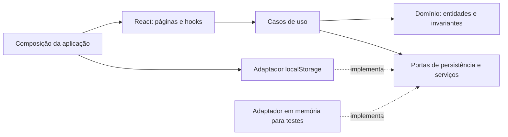

# Arquitetura da aplicação

## Limites e fluxo

A aplicação é um monólito modular no navegador. DDD define responsabilidades e invariantes; a arquitetura hexagonal separa regras e casos de uso dos adaptadores. Nesta etapa os contextos compartilham um documento de persistência para garantir consistência de catálogo e configurações.

| Pasta                     | Responsabilidade                                                                                   |
| ------------------------- | -------------------------------------------------------------------------------------------------- |
| `src/app`                 | Composição manual de dependências, roteamento e configuração do modo                               |
| `src/app/presentation`    | Contextos React, estado de carregamento e estrutura administrativa                                 |
| `src/modules/restaurant`  | Identidade, contato, configuração de entrega e abertura da loja                                    |
| `src/modules/catalog`     | Categorias, produtos, disponibilidade, leitura do cardápio e persistência do documento             |
| `src/modules/checkout`    | Carrinho, reconciliação, validação de entrega, cálculo e mensagem                                  |
| `src/modules/demo-orders` | Simulação independente do quadro de pedidos, reiniciada ao sair                                    |
| `src/shared`              | Dinheiro, validação comum, resultados, portas técnicas, adaptadores de navegador e UI reutilizável |
| `tests`                   | Regressões, contratos de persistência, componentes e fluxos no navegador                           |

Cada módulo possui apenas as camadas necessárias. Não criar pastas vazias ou um framework de classes base. `demo-orders` não representa um processamento de pedidos real.

### Regras de dependência

- Domínio importa apenas domínio. Não conhece React, repositórios, navegador, transporte ou armazenamento.
- Aplicação conhece domínio e portas; não importa implementações de infraestrutura ou apresentação.
- Apresentação utiliza casos de uso injetados, nunca `localStorage` ou adaptadores concretos.
- Infraestrutura implementa portas e converte dados externos em estruturas validadas.
- `shared` não importa os módulos de negócio. `app/composition.ts` é o local de ligação das implementações.
- Os contextos React da aplicação são a ponte pública de injeção para as telas.

`scripts/check-architecture.mjs` verifica essas regras. Componentes React têm exportação padrão e arquivos descritivos por responsabilidade. Estilos globais, cardápio público, painel e formulários ficam separados.

## Domínio e contratos

`Restaurant` descreve a loja; `Category` e `Product` têm `restaurantId`. O catálogo exige categorias e identificadores únicos, nomes de categoria normalizados e referências válidas. `Cents` representa centavos inteiros seguros; preços são positivos e taxas podem ser zero. Entradas decimais aceitam vírgula ou ponto com até duas casas, sem separadores de milhares.

`MenuDocument` é o contrato de consistência e persistência: `schemaVersion: 1`, `revision`, restaurante, categorias e produtos. O parser valida os dados novamente a cada leitura e escrita. O contrato não promete tabelas ou um esquema específico de banco.

`MenuRepository` oferece:

- `load(restaurantId): Promise<MenuDocument>`: devolve um documento validado ou rejeita com falha tipada.
- `commit(restaurantId, expectedRevision, next): Promise<MenuDocument>`: verifica a revisão e salva o conjunto; retorna a nova revisão somente após confirmação.
- `subscribe(restaurantId, listener)`: notifica mudanças daquele restaurante e retorna uma função de cancelamento.

`RestaurantDirectory.resolve(slug)` separa resolução pública do repositório. A implementação demonstrativa aceita somente `burger-house`; o armazenamento e os casos de uso já recebem o restaurante explicitamente.

Outras portas: `AccessPolicy`, `DiagnosticLogger`, `IdGenerator`, `ExclusiveLock` e `ImageReader`. A leitura de imagem recebe um contrato estrutural de bytes, tamanho e MIME; `FileReader`, decodificação e `Blob` ficam no adaptador.

Casos de uso retornam `Promise<Result<T>>`, com sucesso discriminado ou `AppError`. Nenhuma camada visual precisa interpretar mensagens de exceção para decidir o comportamento. `Failure` transporta códigos e contexto técnico controlado entre adaptadores e aplicação; o executor converte exceções inesperadas em erro seguro.

## Consistência local e migração

A chave atual é `saas-cardapio:v1:restaurant:<id>`. O adaptador obtém um Web Lock para essa chave, relê a revisão, valida e realiza um único `setItem`. Assim, categoria e produto são gravados juntos. Outra aba com revisão antiga recebe `CONFLICT`; seus campos permanecem disponíveis para revisão. Repositórios em memória preservam isolamento e a mesma semântica de revisão nos testes.

Notificações locais e eventos `storage` atualizam assinantes. Carregamentos têm contador de geração para descartar respostas antigas. Telas preservam o último documento durante erros, exibem a falha e bloqueiam operações dependentes; isso não autoriza uso de dados obsoletos no checkout.

A migração executa somente na demonstração e quando falta a chave nova. Chaves legadas ausentes recebem exclusivamente os padrões do aplicativo antigo. Chaves existentes são integralmente validadas; listas vazias permanecem vazias. Valores em reais são convertidos para centavos. A configuração explícita de WhatsApp começa desabilitada, e o número conhecido dos exemplos fica vazio no documento migrado, evitando tratá-lo como um destino confirmado. Telefones diferentes do exemplo são preservados, ainda desabilitados até salvar as configurações. Os originais não são removidos nem regravados.

## Evoluir para API e banco

1. Implementar no backend autenticação, autorização por restaurante e casos de uso equivalentes usando o domínio independente de React. O servidor deriva o restaurante autorizado da sessão e valida o acesso ao recurso solicitado.
2. Implementar `MenuRepository` transacional no servidor. Substituir revisão local por controle otimista persistido e garantir a gravação conjunta de categoria e produto.
3. Criar um adaptador HTTP no cliente que cumpra a porta assíncrona, valide respostas e mapeie erros para os códigos existentes. Novas notificações podem usar polling ou transporte de eventos, preservando o cancelamento de assinatura.
4. Substituir `RestaurantDirectory` e `AccessPolicy` na composição. Controles do cliente continuam sendo UX; a autorização efetiva pertence ao servidor.
5. Executar os mesmos testes de contrato contra o novo adaptador. Não habilitar modo real enquanto essas dependências não estiverem implementadas.

O carrinho e os dados pessoais não são persistidos. O link WhatsApp contém o texto codificado apenas para o usuário encaminhar. Não há recibo, confirmação de entrega da mensagem, estado de pedido ou confirmação de pagamento associado a esse link.
